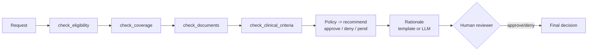

# PreAuth Agent

**A medical prior-authorization agent with tools, MCP, and a human approval step.**

PreAuth Agent decides the first pass of a prior-authorization request: it gathers the
facts with tools (eligibility, coverage, documents, clinical criteria), recommends an
outcome, writes a rationale, and then **a human makes the final call**. The agent never
approves on its own.

> All data is **synthetic** and the clinical rules are illustrative, not medical advice.
> No real patient data is involved.

[](.github/workflows/ci.yml)
[](pyproject.toml)
[](LICENSE)

---

## Why it exists

Prior authorization is slow: someone has to check whether the member is covered, whether
the procedure is a benefit, whether the required documents are present, and whether the
clinical criteria are met. An agent can do that first pass in seconds. But a health
decision must be **safe**, so this agent is built on two rules:

1. **The decision is rule-based, not an LLM guess.** Eligibility, coverage, and clinical
   criteria are deterministic checks. They are explainable and reproducible. The LLM only
   writes the rationale text.
2. **A human always decides.** The agent recommends `approve`, `deny`, or `pend`. The
   final status is set by a reviewer. The agent cannot approve anything by itself.

## How it works



The decision policy:

* not eligible, or procedure not covered, or criteria not met → **deny**
* required documents missing → **pend** (ask for the documents)
* everything passes → **approve** (recommendation only; a human confirms)

## Tools, and MCP

The four checks are **tools**: small, focused functions over the reference data. The agent
calls them in order. The same tools are also exposed over the **Model Context Protocol
(MCP)**, so any MCP client (an IDE, another agent, a desktop assistant) can use them
directly:

```bash
pip install 'preauth-agent[mcp]'
python -m preauth.mcp_server       # serves the tools over stdio
```

This keeps one source of truth for the tools and makes them reusable outside this service.

## Quickstart

```bash
python -m venv .venv && source .venv/bin/activate
make install
make demo          # run the sample requests end to end (approve / pend / deny)
make test          # full test suite
make run           # serve the API on http://localhost:8000 (docs at /docs)
```

### The API

| Method | Path | What it does |
|---|---|---|
| `GET` | `/health` | Liveness check |
| `POST` | `/preauth` | Submit a request; the agent returns a decision packet |
| `GET` | `/preauth/{id}` | Fetch a decision packet |
| `POST` | `/preauth/{id}/approve` | A human applies the final decision |

```bash
curl -s -X POST http://localhost:8000/preauth -H 'content-type: application/json' -d '{
  "member_id": "M1001", "procedure_code": "BAR001", "diagnosis_code": "E66.01",
  "clinical_data": {"bmi": 42.0, "months_conservative_treatment": 8},
  "submitted_documents": ["bmi_report", "nutrition_evaluation", "psych_evaluation"]
}'
```

## Provider-agnostic LLM

The rationale text can be written by an LLM, through a **provider cascade** (`preauth/llm/`):
Anthropic, OpenAI, Gemini, DeepSeek, or a local Ollama model, with fallback to the next one
if one fails. Set `PA_RATIONALE_MODE=llm` and `PA_LLM_PROVIDERS`. The default mode is
`template`, which needs no LLM. The LLM never makes the decision — only the wording.

## Project layout

```
preauth/
  schema.py     request and decision-packet models
  data.py       synthetic members, coverage, criteria, documents
  tools/        the four checks (eligibility, coverage, documents, clinical)
  agent.py      gathers facts, applies the policy, writes the rationale
  service.py    stores packets and applies the human decision
  mcp_server.py exposes the tools over MCP
  llm/          provider-agnostic LLM cascade
  main.py       FastAPI endpoints
  cli.py        the demo
```

## Testing and quality

* **27 tests** cover the tools, the agent (approve/deny/pend and never-auto-approve), the
  service approval flow, the API, the MCP server build, and the LLM cascade. CI requires at
  least 80% coverage.
* `ruff` for lint, `bandit` and `gitleaks` for security.

See [`docs/architecture.md`](docs/architecture.md), the [ADRs](docs/adr/), and the Spanish
study guide in [`docs/estudio/`](docs/estudio/).

## Honest limits

The clinical rules are a small illustrative set, not real guidelines. A production system
would load criteria from maintained clinical-guideline sources, log every decision for
audit, and keep a strict boundary between the automated checks and the human decision — the
boundary this project is built around.

## License

[MIT](LICENSE) © Angelo David Padilla Romero
