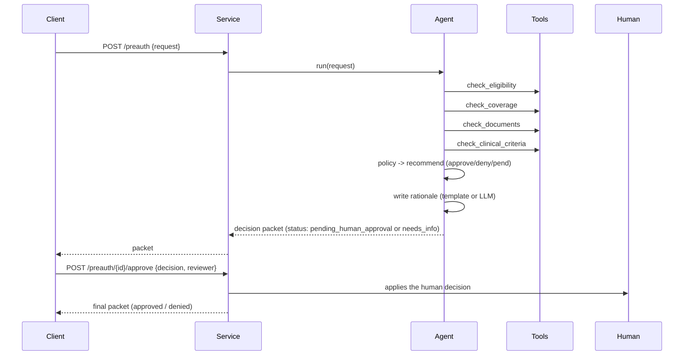

# Architecture

## Goal

Run the first pass of a prior-authorization request safely: gather facts with tools, apply
a rule-based policy, and hand the final decision to a human.

## Components

| Layer | Module | What it does |
|---|---|---|
| Schema | `schema.py` | Request and decision-packet models |
| Data | `data.py` | Synthetic members, coverage, criteria, documents |
| Tools | `tools/` | The four checks, each a focused function |
| Agent | `agent.py` | Gathers facts, applies the policy, writes the rationale |
| Service | `service.py` | Stores packets, applies the human decision |
| MCP | `mcp_server.py` | Exposes the tools over the Model Context Protocol |
| LLM | `llm/` | Provider-agnostic cascade (rationale text only) |
| API | `main.py` | FastAPI endpoints |

## The agent loop

## Two safety rules (the point of the project)

**Rule-based decision.** Eligibility, coverage, and clinical criteria are deterministic
checks in `tools/`. They always give the same answer for the same input and can be
explained line by line. The LLM is never in the decision path — it only turns the findings
into readable text. In a health or benefit decision, "the model said so" is not acceptable.

**Human in the loop.** The agent sets the status to `pending_human_approval` (or
`needs_info` when documents are missing). The final `approved` / `denied` status can only be
set through the approval step, by a named reviewer. The service refuses to approve a request
that is not awaiting human approval.

## Tools and MCP

Each tool is a plain function with a clear input and a dict result. They live in `tools/`
and are collected in a registry. The agent calls them directly, and `mcp_server.py` exposes
the same functions over MCP, so one definition serves both the service and any external MCP
client.

## Provider-agnostic LLM

The rationale writer uses the `llm/` cascade: one `LLMClient` interface, adapters for
several providers, and a `CascadeLLM` that falls back on failure. It is only used for the
wording, and it falls back to a template if no provider is available, so the agent always
produces a rationale.

## Configuration

Settings use the `PA_` prefix (see `.env.example`): the rationale mode (`template` or
`llm`) and the provider order.
